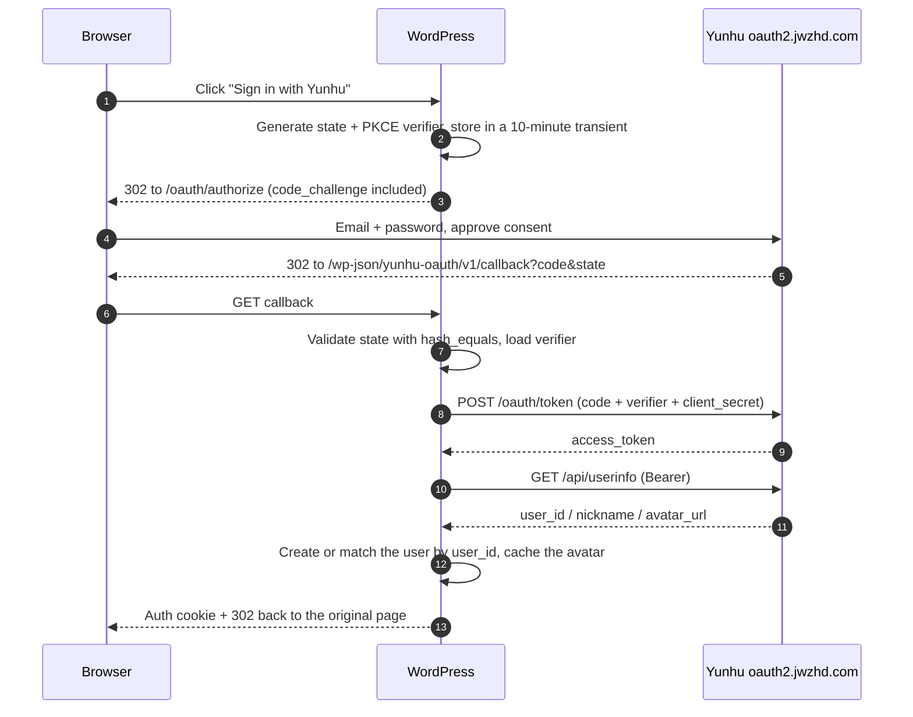

# Yunhu OAuth2 Login for WordPress

[](https://wordpress.org/)
[](https://www.php.net/)
[](https://www.gnu.org/licenses/agpl-3.0.html)
[](readme.txt)

**English** · [简体中文](README.md)

Sign in to WordPress with a Yunhu (云湖) account. Implements the OAuth 2.0 authorization-code flow with mandatory PKCE S256, provisions a local account from `user_id`, and syncs nickname plus avatar (including hotlink-protection handling).

> Unofficial community plugin. Not affiliated with Yunhu.

## Features

- Standard **authorization code** flow with **PKCE S256** (plain is not supported by the provider)
- **CSRF protection**: 64-character random `state`, bound to the browser session, single-use, 10-minute TTL
- **Auto registration** on first login with a configurable default role
- **Account linking**: users can link or unlink from their profile screen; one Yunhu account maps to exactly one WordPress user
- **Local avatar cache**: Yunhu images are hotlink-protected, so avatars are downloaded into `uploads/` during login
- **Two callback flavours**: REST route (default, no query string) or `admin-post.php` when REST is blocked
- **Shortcode** `[yunhu_login]` for any page
- **No token storage**: the access token is used once to fetch the profile and discarded; refresh tokens are not persisted
- **Debuggable**: optional request/response logging with automatic secret redaction

## Requirements

| Item | Requirement |
|---|---|
| WordPress | 5.8+ |
| PHP | 7.4+ |
| Transport | **HTTPS is mandatory in production** (HTTP allowed only for `127.0.0.1`, `localhost`, `::1`) |

## Installation

1. Download `wp-yunhu-oauth.zip` from this repository's releases, or zip the source tree yourself.
2. WordPress admin → Plugins → Add New → Upload Plugin → choose the zip → Install.
3. Activate **云湖 OAuth2 登录**.

Manual alternative:

```bash
cd wp-content/plugins
git clone https://github.com/liutexi/wp-yh-oauth.git wp-yunhu-oauth
```

## Configuration

### 1. Create the application

Open the Yunhu OAuth2 authorization bot (bot ID `45781752`) and register an app. You will receive a `client_id` and a `client_secret`.

### 2. Register the callback URL

The provider matches the **full callback URL byte for byte** — scheme, host, port, path, query string and trailing slash all matter, and the length limit is 255 bytes. Register exactly this value (the settings screen displays a copyable version):

```
https://your-domain.com/wp-json/yunhu-oauth/v1/callback
```

> If a security plugin blocks anonymous `/wp-json/` requests, switch **Callback handler** to `admin-post.php` on the settings screen and register the newly displayed URL instead.

### 3. Enter credentials

Settings → 云湖登录 (`Settings → Yunhu Login`). Storing the secret in `wp-config.php` is recommended:

```php
define( 'YUNHU_OAUTH_CLIENT_ID', 'your client id' );
define( 'YUNHU_OAUTH_CLIENT_SECRET', 'your client secret' );
```

### 4. Verify

Log out, click **使用云湖账号登录** on the login screen, approve the consent screen, and you should land back signed in.

## Flow



## Key settings

| Setting | Default | Notes |
|---|---|---|
| Enabled | on | Turning it off hides the button and rejects callbacks |
| Show on login page | on | Injects the button into `wp-login.php` |
| Client ID / Secret | — | Overridable via `wp-config.php` constants |
| Authorize endpoint | `https://oauth2.jwzhd.com/oauth/authorize` | |
| Token endpoint | `https://oauth2.jwzhd.com/oauth/token` | `application/x-www-form-urlencoded` |
| Userinfo endpoint | `https://oauth2.jwzhd.com/api/userinfo` | |
| Scope | `openid profile` | `openid` → `user_id`, `profile` → `nickname` and `avatar_url` |
| Token auth method | `client_secret_post` | Try `client_secret_basic` on `invalid_client` |
| Callback handler | REST route | Fallback: `admin-post.php` |
| Auto registration | on | When off, only pre-linked accounts may sign in |
| Sync profile | on | Refresh nickname and avatar on every login |
| Cache avatar locally | on | See below |
| Avatar Referer | `https://chat-go.jwzhd.com/` | Domain whitelisted by the CDN |
| Debug log | off | Enable while troubleshooting, disable afterwards |

## Avatars & hotlink protection

Yunhu images reject foreign referrers, so avatars are cached under:

```
wp-content/uploads/yunhu-avatars/{md5(user_id|url)}.{png|jpg|webp|gif|avif}
```

- Referer is retried in order: configured value → `https://chat-go.jwzhd.com/` → `https://www.yhchat.com/` → the image's own origin → no Referer header, **only** on HTTP 401/403
- Download is validated with `getimagesizefromstring` (content bytes, not `Content-Type`), capped at 2 MB, and performed through `wp_safe_remote_get()` which also blocks private addresses
- An unchanged avatar URL reuses the cached file; a changed URL re-downloads and removes the old file
- Failure never blocks login — the remote URL is used instead and the `` gets `referrerpolicy="no-referrer"`
- Unlinking the account deletes the cached file

## Shortcode

```php
[yunhu_login]
[yunhu_login label="Sign in with Yunhu" redirect="/account/" class="my-btn"]
```

Hidden for signed-in users.

## Hooks

### Filters

| Hook | Arguments | Purpose |
|---|---|---|
| `yunhu_oauth_settings` | `$settings` | Override any setting at runtime |
| `yunhu_oauth_authorize_args` | `$args` | Modify authorization parameters |
| `yunhu_oauth_authorize_url` | `$url, $args` | Replace the authorize URL entirely |
| `yunhu_oauth_token_request_body` | `$body` | Modify the token request body |
| `yunhu_oauth_http_args` | `$args, $url, $method` | Adjust requests (proxy, timeout, TLS) |
| `yunhu_oauth_raw_user` | `$data` | Inspect the raw userinfo payload |
| `yunhu_oauth_user_profile` | `$profile, $raw` | Reshape the normalized profile |
| `yunhu_oauth_avatar_request_args` | `$args, $url, $referer` | Tune the avatar download |
| `yunhu_oauth_avatar_referers` | `$candidates, $url` | Replace the Referer chain |

### Actions

| Hook | Arguments | Fires |
|---|---|---|
| `yunhu_oauth_user_created` | `$user_id, $profile` | After a new account is provisioned |
| `yunhu_oauth_login` | `$user_id, $profile` | After every successful login, before redirect |

```php
add_filter( 'yunhu_oauth_user_profile', function ( $profile ) {
	$profile['nickname'] = 'Yunhu · ' . $profile['nickname'];

	return $profile;
} );
```

## Stored data

| User meta | Content |
|---|---|
| `yunhu_oauth_uid` | Yunhu `user_id` — the only account link |
| `yunhu_oauth_avatar` | Original avatar URL |
| `yunhu_oauth_avatar_file` | Cached file, relative to the uploads directory |
| `yunhu_oauth_avatar_source` | URL the cache was built from |
| `yunhu_oauth_managed` | Account was created by this plugin |
| `yunhu_oauth_bound_at` | Link timestamp |

Option: `yunhu_oauth_settings`. Uninstall removes options and stale transients but **keeps account links** so a reinstall does not orphan users.

## Security notes

- `state` compared with `hash_equals()`, transient read once and deleted
- Callback parameters fall back to scanning the raw `REQUEST_URI` for providers that mis-join query strings
- The token exchange reuses the original `code_verifier`; it is never regenerated
- `redirect_to` passes through `wp_validate_redirect()`; external redirects are limited to the authorize endpoint
- The client secret is never echoed into HTML; an empty field keeps the stored value
- No access or refresh tokens are written to the database
- Yunhu does not return an email address, so there is deliberately **no** email-based account merging

## Troubleshooting

| Symptom | Likely cause | Fix |
|---|---|---|
| "登录状态校验失败" (state mismatch) | Cookies blocked, domain changed, or consent screen left open over 10 minutes | Retry; check cookie settings |
| "换取访问令牌失败" (token exchange failed) | Wrong secret, mismatched callback, wrong auth method | Enable debug log; try `client_secret_basic` on `invalid_client` |
| "未拿到云湖用户 ID" (no user id) | Scope lacks `openid` | Keep scope at `openid profile` |
| Callback 404 | REST API blocked by a security plugin | Switch callback handler to `admin-post.php` and re-register |
| Authorize page returns raw 400 JSON | Invalid authorization request | Compare the registered callback with the one shown in settings |
| Avatar missing | Hotlink protection | Check the log for `头像请求返回 HTTP xxx`; adjust Avatar Referer |

Invalid authorization parameters are rejected by the provider with a plain HTTP 400 JSON response — the browser never returns to the site, so those cases must be diagnosed from logs.

## Development

```bash
find . -name "*.php" -exec php -l {} \;
```

CI runs `php -l` on PHP 7.4 through 8.3 and verifies that the plugin header version, the `YUNHU_OAUTH_VERSION` constant and `readme.txt`'s `Stable tag` all match. Pushing a `v*` tag builds `wp-yunhu-oauth.zip` and attaches it to the GitHub release.

## License

[AGPL-3.0-or-later](https://www.gnu.org/licenses/agpl-3.0.html) — see [LICENSE](LICENSE).
