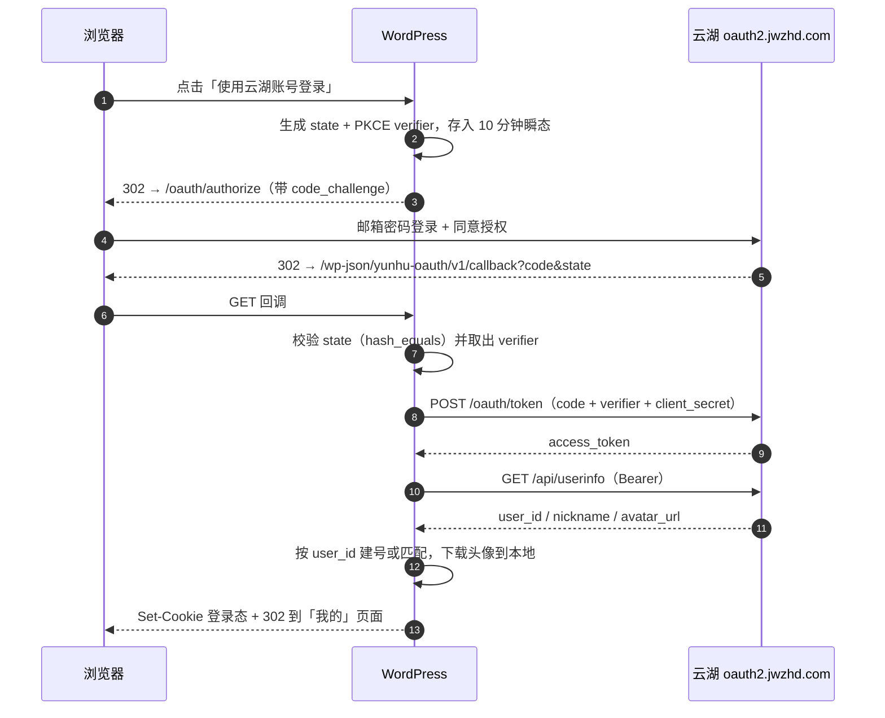

# 云湖 OAuth2 登录 for WordPress

**简体中文** · [English](README.en.md)

[](https://wordpress.org/)
[](https://www.php.net/)
[](https://www.gnu.org/licenses/agpl-3.0.html)
[](readme.txt)

让 WordPress 站点支持「使用云湖账号登录」，并自带一个「我的」账号页面。基于云湖 OAuth2 授权码模式 + 强制 PKCE S256，登录后按 `user_id` 建立本地账号，把昵称、头像（含防盗链处理）同步到站点，用户则在 `/my/` 查看自己的账号与绑定状态。

> 本项目是第三方社区插件，非云湖官方产品。

## 特性

- **标准 OAuth 2.0 授权码流程**，强制 PKCE S256（云湖不支持 `plain`）
- **state 防 CSRF**：64 位随机串，绑定浏览器会话，10 分钟过期、一次性消费
- **自动注册**：首次登录创建本地账号，可指定默认角色
- **账号绑定**：老用户可在个人资料页手动绑定 / 解绑，一个云湖账号只能绑一个站点账号
- **头像本地化**：云湖图片有防盗链，登录时下载到 `uploads/yunhu-avatars/`，站内不再 403
- **两种回调实现**：REST 路由（默认，地址无查询参数）/ `admin-post.php`（REST 被禁用时）
- **「我的」页面**：插件自带的 `/my/` 账号页，头像、账号信息、云湖绑定、改名、解绑、退出登录一站完成
- **登录后落地**：订阅者登录（含云湖授权）直接进「我的」，不再被丢进 `wp-admin`
- **短代码**：`[yunhu_login]` 放登录按钮，`[yunhu_me]` 把账号面板嵌进任意页面
- **无令牌落地**：access token 仅用于拉一次用户信息，不写入数据库，不涉及刷新流程
- **可观测**：内置调试日志开关，请求/响应写 `error_log` 且自动脱敏

## 环境要求

| 项目 | 要求 |
|---|---|
| WordPress | 5.8 及以上 |
| PHP | 7.4 及以上 |
| 站点协议 | **生产环境必须 HTTPS**（云湖仅允许 `127.0.0.1` / `localhost` / `::1` 走 HTTP） |

## 安装

### 方式一：后台上传

1. 从 Releases 下载 `0.2.zip`（附件名即版本号，安装包内目录为 `wp-yunhu-oauth/`），或自行打包本目录
2. WordPress 后台 → 插件 → 安装插件 → 上传插件 → 选择 zip → 立即安装
3. 启用「云湖 OAuth2 登录」

### 方式二：手动部署

```bash
cd wp-content/plugins
git clone <repo-url> wp-yunhu-oauth
```

然后在后台启用插件。

## 配置

### 1. 创建云湖应用

打开云湖 OAuth2 授权机器人（机器人 ID `45781752`），按提示填写应用名称与回调配置，拿到 `client_id` 与 `client_secret`。

### 2. 登记回调地址

云湖按**完整 URL 精确匹配**，协议、主机、端口、路径、查询参数、末尾斜杠任一不同都会失败，长度上限 255 字节。

插件默认使用 REST 路由，请把下面这一行原样填进云湖应用配置（设置页顶部也会显示，可直接复制）：

```
https://你的域名/wp-json/yunhu-oauth/v1/callback
```

> 若站点禁用了 REST API（部分安全插件会拦截匿名 `/wp-json/` 访问），在设置页把「回调实现方式」改为 `admin-post.php`，并把新地址重新登记。

### 3. 填入凭据

「设置 → 云湖登录」填写 Client ID / Client Secret，保存。

推荐把密钥放进 `wp-config.php`，避免入库：

```php
define( 'YUNHU_OAUTH_CLIENT_ID', '你的 client id' );
define( 'YUNHU_OAUTH_CLIENT_SECRET', '你的 client secret' );
```

### 4. 验证

退出登录，在登录页点击「使用云湖账号登录」，走完授权后应自动登录并跳到「我的」页面（默认 `/my/`）。

同时检查一下 `/my/` 是否可访问：未登录时应跳转到登录页，登录后回到 `/my/`。若返回 404，见「故障排查」里的伪静态一节。

## 登录流程



## 设置项

| 设置 | 默认 | 说明 |
|---|---|---|
| 启用 | 开 | 关闭后前端不显示入口，回调也会拒绝 |
| 登录页显示 | 开 | 在 `wp-login.php` 表单下方插入按钮 |
| 按钮文案 | 使用云湖账号登录 | 也可用短代码单独指定 |
| Client ID / Secret | — | 支持 `wp-config.php` 常量覆盖 |
| 授权端点 | `https://oauth2.jwzhd.com/oauth/authorize` | |
| Token 端点 | `https://oauth2.jwzhd.com/oauth/token` | `application/x-www-form-urlencoded` |
| 用户信息端点 | `https://oauth2.jwzhd.com/api/userinfo` | |
| Scope | `openid profile` | `openid` → `user_id`；`profile` → `nickname`、`avatar_url` |
| 客户端认证方式 | `client_secret_post` | 返回 `invalid_client` 时可试 `client_secret_basic` |
| 回调实现方式 | REST 路由 | 备选 `admin-post.php` |
| 启用「我的」页面 | 开 | 注册 `/my/` 路由；关闭后仍可用 `[yunhu_me]` |
| 页面别名 | `my` | 改成 `account` 即 `/account/`；与现有页面冲突时设置页会警告 |
| 登录后跳转 | 开 | 无写作权限的用户登录后进「我的」，显式 `redirect_to` 不受影响 |
| 隐藏工具栏 | 关 | 对无写作权限的用户隐藏前台工具栏 |
| 自动注册 | 开 | 关闭则只允许已绑定用户登录 |
| 同步资料 | 开 | 每次登录同步昵称与头像 |
| 本地化头像 | 开 | 见下节 |
| 头像请求 Referer | `https://chat-go.jwzhd.com/` | 防盗链放行的域名 |
| 唯一 ID 字段名 | 空（自动识别） | 云湖返回 `user_id` |
| 调试日志 | 关 | 排查时开启，上线请关闭 |

## 「我的」页面

登录完成后落地的账号页面。默认地址 `https://你的域名/my/`，别名可在设置里改。

页面结构：

| 区块 | 内容 |
|---|---|
| 身份区 | 头像、显示名称、`@登录名`、角色徽章、云湖绑定徽章 |
| 账号信息 | 用户名、显示名称、邮箱、角色、注册时间、上次云湖登录 |
| 云湖账号 | 云湖 `user_id`、云湖昵称、绑定时间；已绑定时可解绑，未绑定时可发起绑定 |
| 显示名称 | 就地改名（带 nonce）；若该账号昵称跟随云湖同步，会提示下次登录将被覆盖 |
| 底部 | 编辑完整资料、返回首页、退出登录 |

实现要点：

- 路由由插件注册（`add_rewrite_rule` + `template_include`），**不创建页面、不写入文章表**，卸载即消失
- 复用主题的 `header.php` / `footer.php`；区块主题没有 `header.php` 时由 WordPress 内置的 theme-compat 头部兜底
- 未登录访问 → 跳登录页，登录后回跳 `/my/`
- `noindex, noarchive` + `nocache_headers()`，避免被搜索引擎收录或被整页缓存
- 站点使用「朴素」固定链接时自动降级为 `?yunhu_me=1`，不会 404
- **不依赖重写规则**：即使规则没写入（升级、迁移、主机改写），也会按请求路径识别 `/my/`，不会 404
- 设置页「路由状态」会显示规则是否已写入，并提供「立即刷新伪静态规则」按钮
- 不想用插件路由：关闭「启用页面」，在任意页面放 `[yunhu_me]`

自定义配色可覆盖 CSS 变量：

```css
.yunhu-me {
	--yh-primary: #0b5fff;
	--yh-radius: 8px;
	--yh-card: #fffdf7;
}
```

## 头像与防盗链

云湖图片启用了防盗链，第三方站点直接 `` 会因 Referer 不符被 403。插件默认把头像下载到本地：

```
wp-content/uploads/yunhu-avatars/{md5(user_id|url)}.{png|jpg|webp|gif|avif}
```

- Referer 按顺序重试：设置值 → `https://chat-go.jwzhd.com/` → `https://www.yhchat.com/` → 图片自身域名 → 不带 Referer，**仅在 401/403 时**换下一个
- 用 `getimagesizefromstring` 校验真实图片字节（不信 `Content-Type`），上限 2 MB，走 `wp_safe_remote_get`（顺带阻断内网地址）
- 头像地址未变则复用本地文件；地址变化时重下并删除旧文件
- 下载失败不影响登录，退回远程地址，并在 `` 上补 `referrerpolicy="no-referrer"`
- 解绑云湖账号时删除该用户的本地头像文件

## 短代码

```php
// 默认按钮
[yunhu_login]

// 自定义文案与登录后跳转
[yunhu_login label="用云湖登录" redirect="/account/" class="my-btn"]
```

已登录用户不会看到按钮。

```php
// 「我的」账号面板，可放进任意页面 / 页面构建器
[yunhu_me]
```

`[yunhu_me]` 与 `/my/` 输出完全一致；未登录时显示登录提示与云湖登录按钮。

## 钩子

### Filters

| 钩子 | 参数 | 用途 |
|---|---|---|
| `yunhu_oauth_settings` | `$settings` | 运行时覆盖任意设置 |
| `yunhu_oauth_authorize_args` | `$args` | 修改授权请求参数 |
| `yunhu_oauth_authorize_url` | `$url, $args` | 整体替换授权地址 |
| `yunhu_oauth_token_request_body` | `$body` | 修改换取令牌的表单体 |
| `yunhu_oauth_http_args` | `$args, $url, $method` | 调整请求（代理、超时、证书等） |
| `yunhu_oauth_raw_user` | `$data` | 处理 userinfo 原始返回 |
| `yunhu_oauth_user_profile` | `$profile, $raw` | 加工归一化后的资料 |
| `yunhu_oauth_avatar_request_args` | `$args, $url, $referer` | 调整头像下载请求 |
| `yunhu_oauth_avatar_referers` | `$candidates, $url` | 替换 Referer 候选链 |
| `yunhu_oauth_account_data` | `$data, $user` | 「我的」页面用到的绑定信息 |

### Actions

| 钩子 | 参数 | 触发时机 |
|---|---|---|
| `yunhu_oauth_user_created` | `$user_id, $profile` | 首次登录自动建号后 |
| `yunhu_oauth_login` | `$user_id, $profile` | 每次登录成功、跳转之前 |
| `yunhu_oauth_account_before` | `$user` | 「我的」页面内容渲染前 |
| `yunhu_oauth_account_sections` | `$user` | 「我的」页面主体之后，用于追加自定义区块 |

示例——给新用户加前缀并落入自定义用户组：

```php
add_filter( 'yunhu_oauth_user_profile', function ( $profile, $raw ) {
	$profile['nickname'] = '云湖·' . $profile['nickname'];

	return $profile;
}, 10, 2 );

add_action( 'yunhu_oauth_user_created', function ( $user_id, $profile ) {
	update_user_meta( $user_id, 'member_group', 'yunhu' );
}, 10, 2 );
```

## 数据存储

| 用户元数据键 | 内容 |
|---|---|
| `yunhu_oauth_uid` | 云湖 `user_id`，账号关联的唯一依据 |
| `yunhu_oauth_avatar` | 云湖返回的原始头像地址 |
| `yunhu_oauth_avatar_file` | 本地缓存文件（相对 uploads 的路径） |
| `yunhu_oauth_avatar_source` | 生成缓存时的原始地址，用于判断是否需要重下 |
| `yunhu_oauth_managed` | 该账号由插件创建（只有这类账号会被同步覆盖昵称） |
| `yunhu_oauth_bound_at` | 绑定时间戳 |
| `yunhu_oauth_nickname` | 最近一次同步的云湖昵称 |
| `yunhu_oauth_last_login` | 最近一次云湖登录的时间戳 |

选项：`yunhu_oauth_settings`（数组）；`yunhu_oauth_rules_marker` 记录已刷新的伪静态签名（插件自愈用，可安全删除）。卸载时删除选项与残留瞬态，**保留用户绑定关系**，避免重装后账号失联。

## 安全设计

- `state` 通过 `hash_equals()` 比对，瞬态一次性读取并删除
- 回调参数除 `$_GET` 外还会扫描原始 `REQUEST_URI` 兜底（兼容平台拼参异常）
- 授权码兑换使用发起授权时保存的原始 `code_verifier`，绝不重新生成
- `redirect_to` 经 `wp_validate_redirect()`，外部跳转仅限授权端点
- Client Secret 永不回显到页面 HTML，留空即保持原值
- 不写入 access token / refresh token；不依赖昵称等可变字段做关联
- 云湖不返回邮箱，因此**不提供**「按邮箱合并账号」，避免邮箱未验证导致的账号接管

## 故障排查

| 现象 | 可能原因 | 处理 |
|---|---|---|
| 提示「登录状态校验失败」 | Cookie 被禁、切域名、授权页停留超过 10 分钟 | 重新点登录；检查站点 Cookie 设置 |
| 提示「换取访问令牌失败」 | Secret 错误 / 回调地址不一致 / 认证方式不符 | 开调试日志看 `error` 字段；`invalid_client` 时换 `client_secret_basic` |
| 提示「未拿到云湖用户 ID」 | scope 缺 `openid` | 保持 scope 为 `openid profile` |
| 回调 404 | REST API 被安全插件拦截 | 切换回调方式为 `admin-post.php` 并重新登记 |
| 授权时页面直接返回 400 JSON | 参数不合法（回调不匹配、PKCE 缺失等） | 核对登记的回调 URL 与插件显示的是否逐字符一致 |
| 头像不显示 | 防盗链未通过 | 看日志中「头像请求返回 HTTP xxx」；调整「头像请求 Referer」 |
| `/my/` 返回 404 | 重写规则未写入（升级、迁移，或主机/安全插件改写了 `rewrite_rules`） | 「设置 → 云湖登录 → 路由状态」看是否「未写入」，点「立即刷新伪静态规则」；0.2.1 起还带按路径识别的兜底路由 |
| `/my/` 显示成了别的页面 | 别名与现有页面重名 | 换一个「页面别名」，保存时会提示冲突 |
| 「我的」页样式与主题冲突 | 主题对 `dl`/`dt`/`dd` 做了强样式 | 用 `.yunhu-me` 作用域覆盖，或用 `[yunhu_me]` 放到自建页面里 |

云湖在参数不合法时会直接返回 HTTP 400 + JSON，不会跳回站点，因此这类问题只能从日志或云湖侧排查。

## 其他平台

不在 WordPress 上（自建站、SaaS、其他 CMS）？`docs/other-platforms/` 提供了协议速查、七步接入流程、部署要点与错误对照，并附带四个可直接运行的示例：

- [非 WordPress 平台接入指南](docs/other-platforms/README.md)
- 示例代码：`docs/other-platforms/examples/` 下的 `php/`、`node/`、`python/`、`go/`

四个示例逻辑一致（授权 → 回调 → 换 token → 取用户 → 建会话），只依赖各自语言的标准库或常见框架。

## 目录结构

```
wp-yunhu-oauth/
├── wp-yunhu-oauth.php                     # 插件入口、常量、激活钩子
├── includes/
│   ├── class-yunhu-oauth-settings.php     # 选项、Settings API、后台设置页
│   ├── class-yunhu-oauth-client.php       # 授权 URL、令牌交换、userinfo、字段映射、PKCE
│   ├── class-yunhu-oauth-avatar.php       # 头像下载、缓存、Referer 重试、清理
│   ├── class-yunhu-oauth-login.php        # state、回调、建号/绑定、登录、短代码
│   ├── class-yunhu-oauth-profile.php      # 资料页绑定/解绑、头像输出
│   └── class-yunhu-oauth-account.php      # 「我的」页面：路由、渲染、改名、登录跳转
├── templates/account.php                  # 「我的」页面模板（复用主题 header/footer）
├── assets/css/yunhu-oauth.css
├── assets/css/yunhu-oauth-account.css
├── docs/other-platforms/                  # 非 WordPress 平台接入指南 + 四语言示例
├── uninstall.php
├── LICENSE                                # AGPL-3.0 全文
├── readme.txt                             # WordPress 插件市场格式说明
└── README.md
```

## 开发

```bash
# 语法检查
find . -name "*.php" -exec php -l {} \;
```

代码遵循 WordPress Coding Standards 的命名与转义习惯（`esc_html` / `esc_url` / `esc_attr`），所有输入经 `sanitize_*` 处理，写库走 `update_option` / `update_user_meta`。

## 许可证

[AGPL-3.0-or-later](https://www.gnu.org/licenses/agpl-3.0.html)，全文见 [LICENSE](LICENSE)。

WordPress 自身为 "GPLv2 or later"，因此在 GPLv3 路径下可与 AGPL-3.0 组合分发。若你把这个插件并入闭源分发的产品，AGPL 的网络服务条款（第 13 条）会要求向通过网络交互的用户提供对应源码——商用前请确认这一点符合你的预期。

## 致谢

接口规范依据《云湖 OAuth2 接入文档（第一版）》。若云湖后续调整端点或字段，插件设置页可直接改端点，无需改代码；字段名变化可用「唯一 ID 字段名」等四个输入框或 `yunhu_oauth_user_profile` 过滤器适配。
