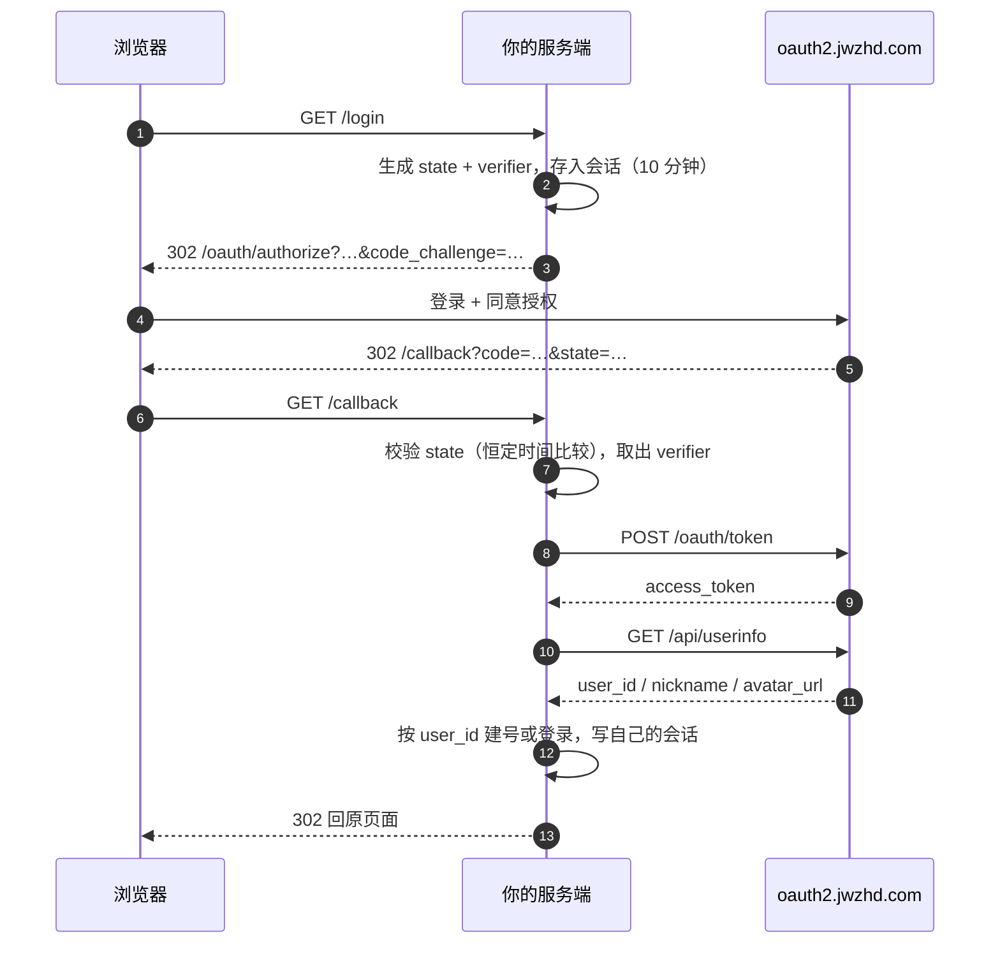

# 云湖 OAuth2 登录 · 非 WordPress 平台接入指南

这份文档面向**不用 WordPress** 的场景（自建站、SaaS、内部工具、其他 CMS），说明如何接入云湖账号登录。仓库根目录的 WordPress 插件可以当作实现参考，但下面的代码不依赖它。

- 语言/框架示例：[PHP](#php-原生) · [Node.js](#nodejs--express) · [Python](#python--flask) · [Go](#go-标准库)
- 其他 CMS 的落点：[见文末](#其他-cms-的接入落点)
- 只想看参数：[速查表](#1-协议速查)

示例代码在 `examples/` 下，可直接对照运行。

## 目录

1. [协议速查](#1-协议速查)
2. [七步接入](#2-七步接入)
3. [各平台实现](#3-各平台实现)
4. [部署要点](#4-部署要点)
5. [头像与防盗链](#5-头像与防盗链)
6. [错误对照](#6-错误对照)
7. [安全清单](#7-安全清单)
8. [与 WordPress 插件的职责对照](#8-与-wordpress-插件的职责对照)
9. [其他 CMS 的接入落点](#其他-cms-的接入落点)

---

## 1. 协议速查

服务地址：`https://oauth2.jwzhd.com`

| 方法 | 路径 | 用途 |
|---|---|---|
| GET | `/oauth/authorize` | 浏览器跳转授权 |
| POST | `/oauth/token` | 用 code 换 token（`application/x-www-form-urlencoded`） |
| GET | `/api/userinfo` | 取用户信息（`Authorization: Bearer`） |
| GET | `/oauth/grants` | 用户查看/撤销已授权应用（给用户用，不是给应用调） |

授权请求参数：

| 参数 | 必填 | 说明 |
|---|---|---|
| `response_type` | 是 | 固定 `code` |
| `client_id` | 是 | 应用标识 |
| `redirect_uri` | 是 | 已登记的**完整**回调地址 |
| `scope` | 否 | 建议 `openid profile`（省略时服务端默认也是它） |
| `state` | 是 | 32–128 字符随机串 |
| `code_challenge` | 是 | `BASE64URL(SHA256(verifier))` |
| `code_challenge_method` | 是 | 固定 `S256`，不支持 `plain` |

换 token 的表单字段：`grant_type=authorization_code`、`code`、`redirect_uri`、`client_id`、`client_secret`、`code_verifier`。

成功响应：

```json
{
  "access_token": "…",
  "token_type": "Bearer",
  "expires_in": 7200,
  "refresh_token": "…",
  "scope": "openid profile"
}
```

用户信息（`scope` 含 `openid profile` 时）：

```json
{ "user_id": "…", "nickname": "…", "avatar_url": "https://…" }
```

要点：

- **没有邮箱字段**。账号关联只能用 `user_id`，不要用昵称或头像（可变）。
- `state` 必须 32–128 字符，短了会被拒。
- PKCE 是强制的，`code_verifier` 43–128 字符，只能用 `A-Z a-z 0-9 - . _ ~`。
- 授权码一次性、有效期 10 分钟。
- 回调地址按**完整 URL 逐字节**匹配（协议/主机/端口/路径/查询串/末尾斜杠），上限 255 字节，生产必须 HTTPS。

## 2. 七步接入



1. **配置**：`CLIENT_ID` / `CLIENT_SECRET` 从环境变量读取，回调地址固定为常量。
2. **发起**：生成 `state`（≥32 字符）与 `code_verifier`，一起存进**服务端会话**，`verifier` 绝不发给浏览器。
3. **跳转**：拼授权 URL，带上 `code_challenge`。
4. **回调**：先查会话里的 `state` 做恒定时间比较，再处理 `error`，最后取 `code`。
5. **兑换**：POST 表单换 token，带上原始 `verifier`；同一个授权码只能用一次。
6. **取用户**：`GET /api/userinfo` 带 Bearer。
7. **落地**：以 `user_id` 为唯一键建号/匹配，然后**建立你自己的登录会话**——云湖的 token 不是你的会话凭据。

## 3. 各平台实现

四个示例逻辑一致，差异只在会话与 HTTP 客户端。

### PHP 原生

`examples/php/index.php`，无需 Composer：

```php
<?php
declare(strict_types=1);
session_start();

const AUTHORIZE = 'https://oauth2.jwzhd.com/oauth/authorize';
const TOKEN     = 'https://oauth2.jwzhd.com/oauth/token';
const USERINFO  = 'https://oauth2.jwzhd.com/api/userinfo';

$clientId     = getenv('YUNHU_CLIENT_ID') ?: '';
$clientSecret = getenv('YUNHU_CLIENT_SECRET') ?: '';
$redirectUri  = getenv('YUNHU_REDIRECT_URI') ?: 'https://example.com/callback';

function b64url(string $raw): string {
	return rtrim(strtr(base64_encode($raw), '+/', '-_'), '=');
}

function post_form(string $url, array $fields): array {
	$ch = curl_init($url);
	curl_setopt_array($ch, [
		CURLOPT_POST           => true,
		CURLOPT_POSTFIELDS     => http_build_query($fields),
		CURLOPT_RETURNTRANSFER => true,
		CURLOPT_TIMEOUT        => 15,
		CURLOPT_HTTPHEADER     => ['Accept: application/json'],
	]);
	$body = (string) curl_exec($ch);
	curl_close($ch);

	return json_decode($body, true) ?: [];
}

function get_json(string $url, string $token): array {
	$ch = curl_init($url);
	curl_setopt_array($ch, [
		CURLOPT_RETURNTRANSFER => true,
		CURLOPT_TIMEOUT        => 15,
		CURLOPT_HTTPHEADER     => ["Authorization: Bearer {$token}", 'Accept: application/json'],
	]);
	$body = (string) curl_exec($ch);
	curl_close($ch);

	return json_decode($body, true) ?: [];
}

// 1. 发起授权
if (isset($_GET['login'])) {
	$state    = bin2hex(random_bytes(32));
	$verifier = b64url(random_bytes(48));

	$_SESSION['yh_state']    = $state;
	$_SESSION['yh_verifier'] = $verifier;
	$_SESSION['yh_expires']  = time() + 600;

	$url = AUTHORIZE . '?' . http_build_query([
		'response_type'         => 'code',
		'client_id'             => $clientId,
		'redirect_uri'          => $redirectUri,
		'scope'                 => 'openid profile',
		'state'                 => $state,
		'code_challenge'        => b64url(hash('sha256', $verifier, true)),
		'code_challenge_method' => 'S256',
	]);

	header('Location: ' . $url, true, 302);
	exit;
}

// 2. 回调
if (isset($_GET['code']) || isset($_GET['error'])) {
	$state = (string) ($_GET['state'] ?? '');
	$saved = (string) ($_SESSION['yh_state'] ?? '');
	$verifier = (string) ($_SESSION['yh_verifier'] ?? '');

	unset($_SESSION['yh_state'], $_SESSION['yh_verifier'], $_SESSION['yh_expires']);

	if ('' === $state || '' === $saved || ! hash_equals($saved, $state)) {
		http_response_code(400);
		exit('state 校验失败，请重新登录');
	}
	if (isset($_GET['error'])) {
		http_response_code(400);
		exit('你取消了授权');
	}

	$token = post_form(TOKEN, [
		'grant_type'    => 'authorization_code',
		'code'          => (string) $_GET['code'],
		'redirect_uri'  => $redirectUri,
		'client_id'     => $clientId,
		'client_secret' => $clientSecret,
		'code_verifier' => $verifier,
	]);

	if (empty($token['access_token'])) {
		http_response_code(502);
		exit('换取令牌失败');
	}

	$user = get_json(USERINFO, $token['access_token']);

	if (empty($user['user_id'])) {
		http_response_code(502);
		exit('获取用户失败');
	}

	// 3. 写入你自己的会话（演示：存 session；生产请换成你的用户体系）
	session_regenerate_id(true);
	$_SESSION['uid']      = $user['user_id'];
	$_SESSION['nickname'] = $user['nickname'] ?? '';
	$_SESSION['avatar']   = $user['avatar_url'] ?? '';

	header('Location: /', true, 302);
	exit;
}

// 4. 首页
echo $_SESSION['uid']
	? '已登录：' . htmlspecialchars($_SESSION['nickname'] . ' (' . $_SESSION['uid'] . ')')
	: '<a href="?login=1">使用云湖账号登录</a>';
```

要点：`verifier` 只进 session 不进 URL；`session_regenerate_id(true)` 防会话固定。

### Node.js / Express

`examples/node/server.js`，依赖 `express`、`express-session`，Node 18+ 自带 `fetch`：

```js
import crypto from 'node:crypto';
import express from 'express';
import session from 'express-session';

const AUTHORIZE = 'https://oauth2.jwzhd.com/oauth/authorize';
const TOKEN = 'https://oauth2.jwzhd.com/oauth/token';
const USERINFO = 'https://oauth2.jwzhd.com/api/userinfo';

const CLIENT_ID = process.env.YUNHU_CLIENT_ID ?? '';
const CLIENT_SECRET = process.env.YUNHU_CLIENT_SECRET ?? '';
const REDIRECT_URI = process.env.YUNHU_REDIRECT_URI ?? 'http://127.0.0.1:3000/callback';

const b64url = (buf) => Buffer.from(buf).toString('base64url');
const app = express();

app.use(session({
  secret: process.env.SESSION_SECRET ?? crypto.randomBytes(32).toString('hex'),
  resave: false,
  saveUninitialized: false,
  cookie: { httpOnly: true, sameSite: 'lax', secure: process.env.NODE_ENV === 'production' },
}));

app.get('/login', (req, res) => {
  const state = crypto.randomBytes(32).toString('hex');   // 64 字符
  const verifier = b64url(crypto.randomBytes(48));

  req.session.yh = { state, verifier, expires: Date.now() + 600_000 };

  const url = new URL(AUTHORIZE);
  url.search = new URLSearchParams({
    response_type: 'code',
    client_id: CLIENT_ID,
    redirect_uri: REDIRECT_URI,
    scope: 'openid profile',
    state,
    code_challenge: b64url(crypto.createHash('sha256').update(verifier).digest()),
    code_challenge_method: 'S256',
  }).toString();

  res.redirect(url.toString());
});

app.get('/callback', async (req, res) => {
  const pending = req.session.yh;
  req.session.yh = undefined;

  if (!pending || pending.expires < Date.now() || pending.state !== req.query.state) {
    return res.status(400).send('state 校验失败，请重新登录');
  }
  if (req.query.error) return res.status(400).send('你取消了授权');

  const tokenRes = await fetch(TOKEN, {
    method: 'POST',
    headers: { 'Content-Type': 'application/x-www-form-urlencoded', Accept: 'application/json' },
    body: new URLSearchParams({
      grant_type: 'authorization_code',
      code: String(req.query.code ?? ''),
      redirect_uri: REDIRECT_URI,
      client_id: CLIENT_ID,
      client_secret: CLIENT_SECRET,
      code_verifier: pending.verifier,
    }),
  });
  const token = await tokenRes.json();
  if (!token.access_token) return res.status(502).send('换取令牌失败');

  const userRes = await fetch(USERINFO, {
    headers: { Authorization: `Bearer ${token.access_token}`, Accept: 'application/json' },
  });
  const user = await userRes.json();
  if (!user.user_id) return res.status(502).send('获取用户失败');

  req.session.regenerate((err) => {
    if (err) return res.status(500).send('会话错误');
    req.session.uid = user.user_id;
    req.session.nickname = user.nickname;
    res.redirect('/');
  });
});

app.get('/', (req, res) => {
  res.send(req.session.uid
    ? `已登录：${req.session.nickname} (${req.session.uid})`
    : '<a href="/login">使用云湖账号登录</a>');
});

app.listen(3000);
```

注意 `state` 比较用 `!==` 在 JS 里对定长随机串足够，但若追求恒定时间可换 `crypto.timingSafeEqual`。

### Python / Flask

`examples/python/app.py`，依赖 `flask`、`requests`：

```python
import base64
import hashlib
import os
import secrets

import requests
from flask import Flask, redirect, request, session, url_for

AUTHORIZE = "https://oauth2.jwzhd.com/oauth/authorize"
TOKEN = "https://oauth2.jwzhd.com/oauth/token"
USERINFO = "https://oauth2.jwzhd.com/api/userinfo"

CLIENT_ID = os.environ.get("YUNHU_CLIENT_ID", "")
CLIENT_SECRET = os.environ.get("YUNHU_CLIENT_SECRET", "")
REDIRECT_URI = os.environ.get("YUNHU_REDIRECT_URI", "http://127.0.0.1:5000/callback")

app = Flask(__name__)
app.secret_key = os.environ.get("SESSION_SECRET") or secrets.token_hex(32)


def b64url(raw: bytes) -> str:
    return base64.urlsafe_b64encode(raw).rstrip(b"=").decode()


@app.get("/login")
def login():
    state = secrets.token_urlsafe(32)
    verifier = secrets.token_urlsafe(48)
    session["yh"] = {"state": state, "verifier": verifier}

    challenge = b64url(hashlib.sha256(verifier.encode()).digest())
    params = {
        "response_type": "code",
        "client_id": CLIENT_ID,
        "redirect_uri": REDIRECT_URI,
        "scope": "openid profile",
        "state": state,
        "code_challenge": challenge,
        "code_challenge_method": "S256",
    }
    query = "&".join(f"{k}={requests.utils.quote(str(v), safe='')}" for k, v in params.items())
    return redirect(f"{AUTHORIZE}?{query}")


@app.get("/callback")
def callback():
    pending = session.pop("yh", None)
    state = request.args.get("state", "")

    if not pending or not state or not secrets.compare_digest(pending["state"], state):
        return "state 校验失败，请重新登录", 400
    if request.args.get("error"):
        return "你取消了授权", 400

    token_resp = requests.post(
        TOKEN,
        data={
            "grant_type": "authorization_code",
            "code": request.args.get("code", ""),
            "redirect_uri": REDIRECT_URI,
            "client_id": CLIENT_ID,
            "client_secret": CLIENT_SECRET,
            "code_verifier": pending["verifier"],
        },
        headers={"Accept": "application/json"},
        timeout=15,
    )
    token = token_resp.json()
    if not token.get("access_token"):
        return "换取令牌失败", 502

    user_resp = requests.get(
        USERINFO,
        headers={"Authorization": f"Bearer {token['access_token']}", "Accept": "application/json"},
        timeout=15,
    )
    user = user_resp.json()
    if not user.get("user_id"):
        return "获取用户失败", 502

    session.clear()
    session["uid"] = user["user_id"]
    session["nickname"] = user.get("nickname", "")
    return redirect(url_for("index"))


@app.get("/")
def index():
    if session.get("uid"):
        return f"已登录：{session['nickname']} ({session['uid']})"
    return '<a href="/login">使用云湖账号登录</a>'


if __name__ == "__main__":
    app.run(port=5000, debug=True)
```

### Go 标准库

`examples/go/main.go`，零第三方依赖（演示用内存会话，多实例部署请换 Redis/DB）：

```go
package main

import (
	"crypto/rand"
	"crypto/sha256"
	"encoding/base64"
	"encoding/hex"
	"encoding/json"
	"fmt"
	"io"
	"log"
	"net/http"
	"net/url"
	"os"
	"strings"
	"sync"
	"time"
)

const (
	authorizeURL = "https://oauth2.jwzhd.com/oauth/authorize"
	tokenURL     = "https://oauth2.jwzhd.com/oauth/token"
	userinfoURL  = "https://oauth2.jwzhd.com/api/userinfo"
)

type pending struct {
	verifier string
	expires  time.Time
}

var (
	clientID     = os.Getenv("YUNHU_CLIENT_ID")
	clientSecret = os.Getenv("YUNHU_CLIENT_SECRET")
	redirectURI  = envOr("YUNHU_REDIRECT_URI", "http://127.0.0.1:8080/callback")

	mu       sync.Mutex
	sessions = map[string]pending{} // 生产环境换成 Redis 等共享存储
)

func envOr(key, fallback string) string {
	if v := os.Getenv(key); v != "" {
		return v
	}
	return fallback
}

func randomHex(n int) string {
	b := make([]byte, n)
	_, _ = rand.Read(b)
	return hex.EncodeToString(b)
}

func b64url(b []byte) string {
	return strings.TrimRight(base64.URLEncoding.EncodeToString(b), "=")
}

func main() {
	http.HandleFunc("/login", handleLogin)
	http.HandleFunc("/callback", handleCallback)
	http.HandleFunc("/", handleIndex)

	log.Println("listen :8080")
	log.Fatal(http.ListenAndServe(":8080", nil))
}

func handleLogin(w http.ResponseWriter, r *http.Request) {
	state := randomHex(32)
	verifier := b64url(randomBytes(48))

	mu.Lock()
	sessions[state] = pending{verifier: verifier, expires: time.Now().Add(10 * time.Minute)}
	mu.Unlock()

	sum := sha256.Sum256([]byte(verifier))
	q := url.Values{
		"response_type":         {"code"},
		"client_id":             {clientID},
		"redirect_uri":          {redirectURI},
		"scope":                 {"openid profile"},
		"state":                 {state},
		"code_challenge":        {b64url(sum[:])},
		"code_challenge_method": {"S256"},
	}
	http.Redirect(w, r, authorizeURL+"?"+q.Encode(), http.StatusFound)
}

func handleCallback(w http.ResponseWriter, r *http.Request) {
	state := r.URL.Query().Get("state")

	mu.Lock()
	p, ok := sessions[state]
	delete(sessions, state)
	mu.Unlock()

	if !ok || time.Now().After(p.expires) {
		http.Error(w, "state 校验失败，请重新登录", http.StatusBadRequest)
		return
	}
	if r.URL.Query().Get("error") != "" {
		http.Error(w, "你取消了授权", http.StatusBadRequest)
		return
	}

	form := url.Values{
		"grant_type":    {"authorization_code"},
		"code":          {r.URL.Query().Get("code")},
		"redirect_uri":  {redirectURI},
		"client_id":     {clientID},
		"client_secret": {clientSecret},
		"code_verifier": {p.verifier},
	}

	resp, err := http.PostForm(tokenURL, form)
	if err != nil {
		http.Error(w, "换取令牌失败", http.StatusBadGateway)
		return
	}
	defer resp.Body.Close()

	var token struct {
		AccessToken string `json:"access_token"`
	}
	_ = json.NewDecoder(resp.Body).Decode(&token)
	if token.AccessToken == "" {
		http.Error(w, "换取令牌失败", http.StatusBadGateway)
		return
	}

	req, _ := http.NewRequest(http.MethodGet, userinfoURL, nil)
	req.Header.Set("Authorization", "Bearer "+token.AccessToken)
	req.Header.Set("Accept", "application/json")

	uresp, err := http.DefaultClient.Do(req)
	if err != nil {
		http.Error(w, "获取用户失败", http.StatusBadGateway)
		return
	}
	defer uresp.Body.Close()

	var user struct {
		UserID   string `json:"user_id"`
		Nickname string `json:"nickname"`
	}
	_ = json.NewDecoder(uresp.Body).Decode(&user)
	if user.UserID == "" {
		http.Error(w, "获取用户失败", http.StatusBadGateway)
		return
	}

	// 生产环境：在这里签发你自己的会话 Cookie
	fmt.Fprintf(w, "登录成功：%s (%s)", user.Nickname, user.UserID)
}

func handleIndex(w http.ResponseWriter, r *http.Request) {
	io.WriteString(w, `<a href="/login">使用云湖账号登录</a>`)
}

func randomBytes(n int) []byte {
	b := make([]byte, n)
	_, _ = rand.Read(b)
	return b
}
```

## 4. 部署要点

**回调地址**

- 在云湖应用配置里登记的就是 `REDIRECT_URI` 的**完整字符串**，代码里也必须用同一个常量，不要一处带末尾斜杠、一处不带。
- 反代（Nginx / Cloudflare / 负载均衡）后，对外是 HTTPS 而容器内是 HTTP：`redirect_uri` 要用**对外地址**，不能从 `$_SERVER['HTTP_HOST']` 之类动态拼，否则会与实际访问不一致。

**密钥**

- `CLIENT_SECRET`、`SESSION_SECRET` 只从环境变量读，绝不进代码库、前端 bundle、日志。
- 生产环境对 `client_secret` 使用 basic 认证还是表单字段都行，但**要与代码一致**；本文示例用表单字段（`client_secret_post`）。

**会话**

- `state` 与 `verifier` 必须存在**服务端**。多实例/无状态部署（Serverless、K8s 多 Pod）不能用进程内 Map，要用 Redis、数据库或已签名的加密 Cookie。
- 会话有效期给 10 分钟就够；回调处理完立即删除，避免重放。
- 登录成功后**重新生成会话 ID**（PHP `session_regenerate_id(true)`、Express `req.session.regenerate()`、Flask `session.clear()`）。

**HTTPS**

生产必须 HTTPS。HTTP 仅允许 `127.0.0.1`、`localhost`、`::1` 这类回环地址，方便本地调试。

**日志**

不要记录 `code`、`access_token`、`refresh_token`、`client_secret`。需要排查时记录 HTTP 状态码与 `error` 字段即可。

**不需要保存 token**

如果只是登录，拿到 `user_id` 就可以丢弃 token。要调用云湖其他接口才需要保存，并配合 `refresh_token`（默认 15 天）刷新，注意刷新后旧 token 立即失效。

## 5. 头像与防盗链

`avatar_url` 直接放进 `` 在第三方站点会被拒（防盗链），表现为 403 或裂图。三种处理，按推荐顺序：

1. **服务端下载后本地化**（推荐）：登录时抓取图片存到自己的存储/CDN，页面输出自己的地址。下载时带 `Referer: https://chat-go.jwzhd.com/` 通常即可通过；失败可再试 `https://www.yhchat.com/`、图片自身域名、不带 Referer。
2. **反向代理**：`/avatar/{uid}` 由服务端代理取图并缓存，同样要带 Referer。
3. **前端兜底**：``，部分 CDN 会放行，但不可靠。

下载时建议校验真实图片（PHP `getimagesizefromstring` / Node `file-type` / Python `PIL.Image.open`），并限制大小（如 2 MB）。

## 6. 错误对照

| 现象 | 原因 | 处理 |
|---|---|---|
| `state must be between 32 and 128 characters` | state 太短或含空白 | 用 32 字节随机数转 hex（64 字符） |
| `invalid authorization request` | 缺 PKCE、challenge 格式错、回调不匹配、`response_type` 错 | 逐项核对授权参数 |
| `invalid_scope` | scope 写了不支持的值 | 用 `openid profile` |
| `invalid_client` | client_id / secret 错 | 核对环境变量；确认认证方式一致 |
| `invalid_grant` | code 过期/已用/回调不符，或 verifier 不对 | 重新发起；确认 verifier 与 challenge 同源 |
| userinfo 401 | token 无效/过期/授权被撤销 | 必要时刷新一次，仍失败则重新授权 |
| 回调 400 且未跳回站点 | 授权参数不合法（服务端直接拦截） | 看响应 JSON 的 `error` 字段 |
| 头像 403 | 防盗链 | 见上一节 |

## 7. 安全清单

- [ ] `state` ≥32 字符、一次性、10 分钟过期、恒定时间比较
- [ ] `verifier` 只在服务端，不出现在 URL、HTML、日志
- [ ] 换 token 用原始 `verifier`，不重新生成
- [ ] 回调先校验 `state` 再处理 `code`
- [ ] `client_secret` 仅在服务端
- [ ] 登录成功后轮换会话 ID
- [ ] 账号以 `user_id` 关联，不用昵称/头像/邮箱
- [ ] 生产强制 HTTPS
- [ ] 日志不含令牌与密钥

## 8. 与 WordPress 插件的职责对照

想从本仓库的插件移植到其他平台时，按下表找对应实现：

| 插件文件 | 职责 | 移植时你要写的 |
|---|---|---|
| `class-yunhu-oauth-client.php` | 授权 URL、PKCE、换 token、userinfo、字段映射 | OAuth 客户端（任何一个库都能替代） |
| `class-yunhu-oauth-login.php` | state 存储与校验、回调编排、建号/绑定、登录 | 回调路由 + 用户表逻辑 |
| `class-yunhu-oauth-avatar.php` | 头像下载、缓存、Referer 重试、清理 | 图片本地化 + 定时清理 |
| `class-yunhu-oauth-settings.php` | 配置项与后台表单 | 环境变量 / 配置中心 |
| `class-yunhu-oauth-profile.php` | 绑定/解绑入口、头像输出 | 账号设置页 |

其中**只有两处**值得照抄细节：PKCE 的 `base64url` 实现，以及 `state` 的存储与消费方式。其余都是普通 Web 逻辑。

## 其他 CMS 的接入落点

不同 CMS 的插件机制差别很大，但落脚点都是「一个回调路由 + 一个用户表映射」：

| 平台 | 建议落点 |
|---|---|
| Typecho | 写插件挂 `login`/`Widget_User` 钩子；回调走独立 action 或 `?action=xxx` |
| Halo 2.x | 写插件注册 `Handler` 或 `Router` 暴露 `/oauth/yunhu/callback` |
| Discuz! / Discuz! X | 插件目录下加 `oauth.php` 入口，映射 `common_member` |
| Emlog / Z-BlogPHP | 插件注册前台路由，映射用户表 |
| 静态站 / Hexo / Hugo | 本身无后端，必须借边缘函数、Serverless 或独立认证服务；`client_secret` 绝不能进前端 |
| 前后端分离 SPA | 后端提供 `/login`、`/callback`，前端只负责跳转；不要用隐式模式（云湖也不支持） |

需要哪一个平台的完整插件实现，可以基于本文的流程照着写——协议部分不需要任何改动。

## 相关

- WordPress 插件：[返回仓库首页](../../README.md)
- 插件侧的完整参数说明：[readme.txt](../../readme.txt)
